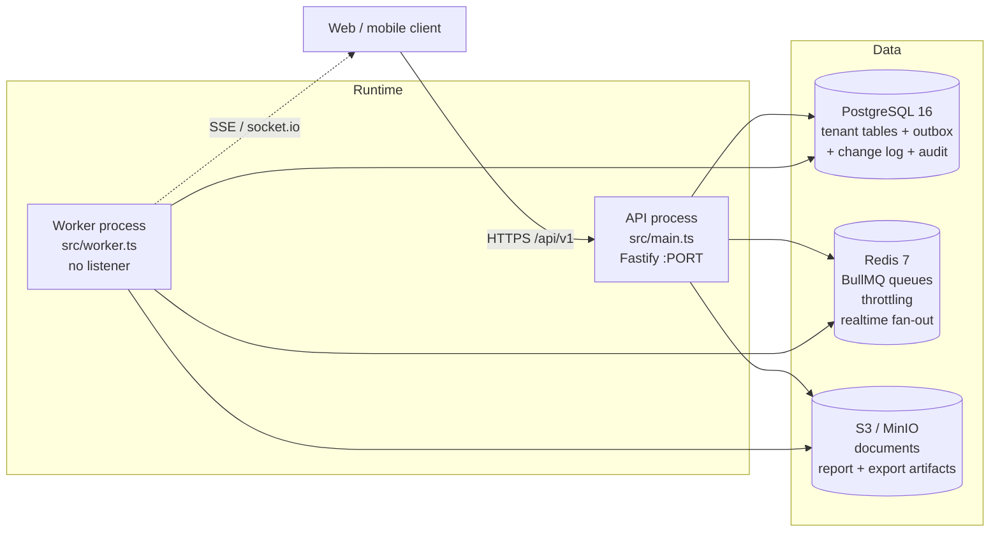
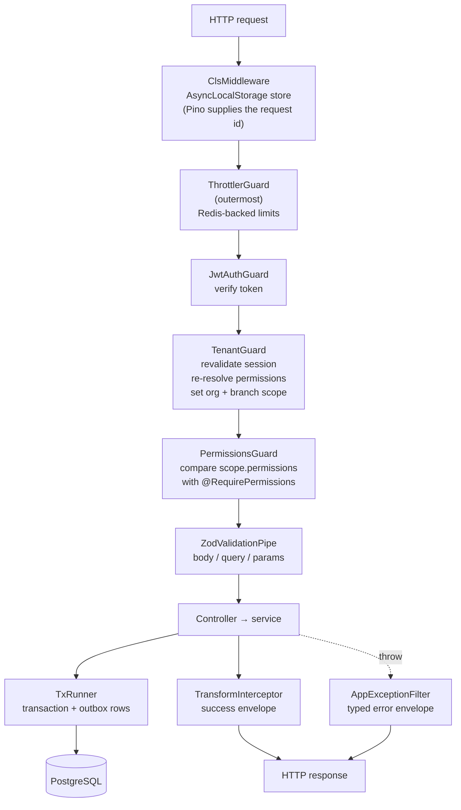
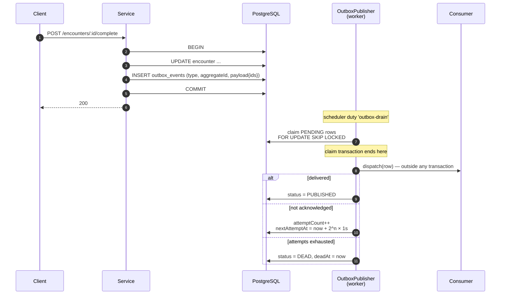

# careOS — Architecture

How the API is put together: the runtime processes, the path a request takes,
the layering rules that are enforced in CI, and the event pipeline that carries
work out of a request and into the worker.

This document describes what the code does today. The decisions behind the
choices are in `docs/decisions.md`; the things that are deliberately not done
are in `docs/limitations.md`.

---

## 1. Runtime topology

Two processes run the same application module, with different entrypoints:

| Process | Entrypoint | Runs |
| --- | --- | --- |
| API | `src/main.ts` | The HTTP server (Fastify) on `PORT`, the versioned routes, Swagger UI (if enabled), health and metrics. |
| Worker | `src/worker.ts` | `NestFactory.createApplicationContext(AppModule)` — no HTTP listener. Every BullMQ processor plus the scheduler duties. |

Both build the **same** `AppModule`. That is deliberate: a module that needs a
queue can own its processor without a second composition root, and the
dependency graph cannot drift between the process that writes an event and the
process that consumes it.

The consequence is worth stating plainly: **the API process also registers the
queue processors**, because there is no worker-mode gate in the module graph.
BullMQ treats multiple workers on one queue as replicas, so a job is still
processed exactly once, and the scheduler's repeatable duties carry fixed
`jobId`s so they are registered once regardless of how many processes boot. A
deployment that wants the API to serve HTTP only sets `SCHEDULER_ENABLED=false`
there and leaves it on for the worker; the flag is the operator's split, not an
automatic one.

The API process does not *have* to drain the outbox: delivery is a scheduler duty
(`outbox-drain`, every `OUTBOX_DRAIN_INTERVAL_MS`), not a loop in the request
path. Which process runs the duty follows from the module graph — both
processes register it — so the honest statement is that a deployment that
leaves `SCHEDULER_ENABLED=true` on the API will deliver from there too, and the
flag is how an operator separates the two. See ADR-044.

## 2. Module graph

`AppModule` (`src/app/app.module.ts`) imports one module per bounded feature,
plus four infrastructure layers:

- `src/common/` — guards, interceptors, filters, decorators, errors, storage,
  auth primitives.
- `src/config/` — environment schema (Zod) and the validated `ENV` token.
- `src/database/` — `PrismaService` (with the tenant extension), `TenantContext`,
  `TxRunner`, `AuditService`, the outbox publisher, Redis and realtime.
- `src/events/` — the event catalogue and the outbox consumer types.
- `src/jobs/` — the shared BullMQ root connection and the queue-name registry.

The four infrastructure layers must not import a feature module. That is
enforced, not merely stated:

| Rule | Enforced by |
| --- | --- |
| `common/` and `config/` never import `modules/` | dependency-cruiser `no-common-to-modules` |
| `database/` never imports `modules/` | dependency-cruiser `no-database-to-modules` |
| No import cycles | dependency-cruiser `no-circular` |
| A `*.repository.ts` is importable only inside its own module | `scripts/check-boundaries.ts` |

The consequence is a visible asymmetry: the outbox **consumer bus** lives in
`src/modules/outbox/` rather than `src/database/`, because assembling consumers
means importing feature modules — which the database layer may not do. The bus
is the one place allowed to know every consumer, so the rule pushes it into the
layer that is allowed to know.

## 3. The request pipeline

Every route declares its authorization and documentation in one decorator,
`@ApiEndpoint` (`src/common/decorators/api-endpoint.decorator.ts`). It sets the
required permissions, the Swagger operation, the success status and the common
error responses together, so a route cannot be documented without being
classified, or classified without appearing in the spec.

A request then passes a fixed chain:

Order matters and is asserted by the provider list order in `AppModule`:

1. **Throttler** is outermost so an abusive caller is rejected before any
   token or database work.
2. **JWT** verifies the credential but does not trust what it says.
3. **TenantGuard** revalidates against the session row and re-resolves
   permissions from the database, so a revoked role or a revoked session
   takes effect on the next request rather than when a JWT expires. It also
   establishes the organization scope and, when `X-Branch-Id` is present and
   the branch is assigned to the caller, the branch scope (ADR-042 — a branch
   header can narrow, never widen).
4. **PermissionsGuard** compares the route's declared permissions with the
   effective set. Routes with no declaration are denied by default
   (`__deny_by_default__`), so forgetting the decorator locks a route rather
   than opening it.

Interceptors run as Transform (outer, wraps the value in the envelope) →
Idempotency (replays a stored response for a repeated `Idempotency-Key`) →
RequestScope (inner, ties the unit of work to the request).

## 4. Units of work: transactions and the outbox

A service that changes more than one row uses `TxRunner`
(`src/database/tx.ts`). Inside a transaction, a domain event is written to
`outbox_events` **in the same transaction as the state change**, so there is no
window in which the data is committed but the event is lost, or the event is
published but the data rolled back. This is the transactional outbox pattern.

The event payload contains **ids only** — never a patient name, a phone number,
or a rendered document. A consumer that needs the data reads it. That keeps the
event table out of scope for the privacy surface and lets a consumer decide for
itself what it may see.

Two properties are load-bearing:

- **The claim is short.** `FOR UPDATE SKIP LOCKED` runs in its own transaction
  and commits before dispatch. Dispatch is network-bound and must not hold row
  locks or a Prisma interactive transaction.
- **Dispatch is idempotent.** Each consumer dedupes on `(organizationId,
  consumer, eventId)` in
  `processed_events`, so a retry after a partial success cannot apply twice.
  The outbox is at-least-once; the consumers make it effectively-once.

A `DEAD` event is not discarded. It is visible at `GET /api/v1/admin/jobs`
together with failed BullMQ jobs, and can be requeued or discarded explicitly
(ADR-059).

## 5. Queues and scheduled duties

BullMQ owns everything asynchronous. The root connection and key prefix are
configured once in `src/jobs/bull-queues.module.ts` (a `@Global()` module);
each feature module registers the queues it owns.

| Queue | Owner | Carries |
| --- | --- | --- |
| `emergency-escalation` | `modules/emergency-intake` | Delayed escalation steps for an emergency request. |
| `scheduler` | `modules/scheduler` | Repeatable time-based duties. |

The scheduler duties, each a repeatable job with a fixed `jobId` so
re-registration does not duplicate it:

| Duty | What it does |
| --- | --- |
| `outbox-drain` | Claims and dispatches ready outbox events. |
| `maintenance-reminders` | Queues due maintenance reminders, per organization, isolated. |
| `idempotency-sweep` | Reclaims expired `COMPLETED` and orphaned `IN_PROGRESS` idempotency records. |
| `report-expiry` | Expires report-export artifacts and clears their storage pointer. |
| `notification-delivery` | Sends due notifications and advances the retry ladder. |
| `display-stale-sweep` | Marks display devices stale after a missed heartbeat. |

Queue names live in one file, `src/jobs/queue-names.ts`, read by both the owning
module and the admin inspection surface. A queue that is not named there is
invisible to the admin surface, so adding a queue means adding it to that file.

## 6. Multi-tenancy

There is one database and one schema. Tenant isolation is applied at three
independent levels, in this order of authority:

1. **The tenant-scoped Prisma client** (`src/database/prisma.service.ts`) is the
   primary control. Application code uses `this.prisma.tenant`, never the raw
   client. An extension intercepts every operation on a model named in
   `TENANT_MODELS` and injects `organizationId` into the `where` clause (and
   into `data` on create). If there is no organization in context, the query
   throws rather than running unscoped.
2. **Row-level security in PostgreSQL** is the backstop, and it is deliberately
   *narrower* than the model list: the policies are on the infrastructure tables
   (`Organization`, `outbox_events`, `processed_events`, `audit_logs`,
   `idempotency_records`, `counters`), keyed on the GUC `app.current_org`. They
   protect the rows written by transactions and platform jobs. The schema owner
   bypasses RLS (the policies are not `FORCE`d), so RLS is not the control for
   the feature tables — the client extension is. It becomes an active backstop
   only when the application connects as `careos_app`; the default compose
   deployment connects as the owner, so there the extension stands alone. The
   policies are exercised by an integration test that connects as `careos_app`.
3. **The route layer.** Permissions are re-resolved per request, and the
   organization comes from the session row, not from the token or the body.

`prisma.unscoped()` is the explicit escape hatch, reserved for audited platform
jobs and the outbox publisher. Every use is a deliberate, reviewable exception.

See `docs/multi-tenancy.md` for the model in full.

## 7. Observability and failure handling

- **Structured logs** — Pino (`nestjs-pino`), with the request id attached by
  `ClsMiddleware`, so a log line can be traced to a request.
- **Typed errors** — `AppError` carries a code from the catalog
  (`src/common/errors/codes.ts`) and an HTTP status. `AppExceptionFilter`
  renders one envelope shape for every failure, with the request id.
- **Audit trail** — `AuditService` writes an append-only `audit_logs` row for
  consequential actions. Rows are written through the same transaction where
  possible; a failed audit write is logged loudly but never rolls back the
  business operation.
- **Failed work is visible, not silent** — dead outbox events and failed queue
  jobs are listable and actionable from the admin surface.

## 8. Reading map

| Question | File |
| --- | --- |
| How does the app start? | `src/main.ts`, `src/worker.ts`, `src/app/app.module.ts` |
| How is a request authorized? | `src/common/guards/*`, `src/common/decorators/api-endpoint.decorator.ts` |
| How is a tenant boundary enforced? | `src/database/prisma.service.ts`, `prisma/migrations/*` (RLS) |
| How does an event get delivered? | `src/database/outbox-publisher.service.ts`, `src/modules/outbox/outbox.module.ts` |
| What runs on a schedule? | `src/modules/scheduler/scheduler.worker.ts` |
| What is a permission? | `src/common/auth/permissions.catalog.ts` |
| Who has which permission? | `src/common/auth/role-matrix.ts` |
| What does the API expose? | `docs/openapi.json` (generated), `src/openapi.ts` |
| Why was it built this way? | `docs/decisions.md` |
