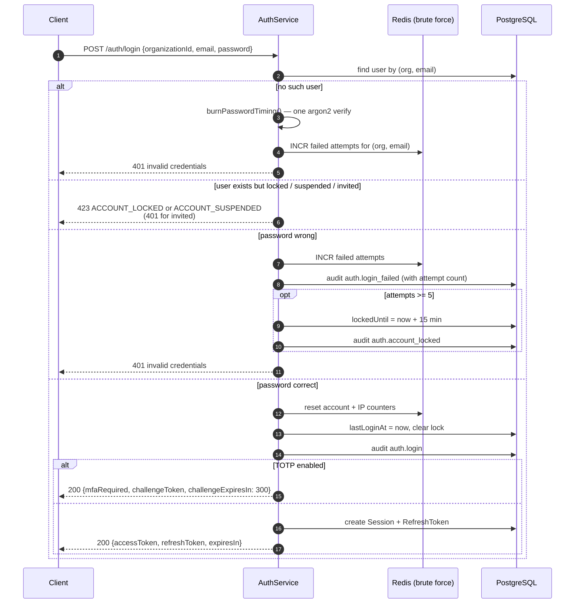

# careOS — Authentication

How a principal proves who it is, how that proof becomes a session, and how the
session is kept honest on every request. Authorization (what a principal may do
once identified) is in `docs/authorization.md`; tenant scoping is in
`docs/multi-tenancy.md`.

---

## 1. Principals

The system authenticates four kinds of principal. They differ in how the
credential is obtained, not in how the request is then treated.

| Principal | Credential | Established by |
| --- | --- | --- |
| Staff user | Access JWT + rotating refresh token | `JwtAuthGuard` + `TenantGuard` |
| Patient (portal) | The same staff flow, with a `PATIENT` role and a linked patient record | `TenantGuard`, via `resolvePatientScope` |
| Display device | A long-lived device token from a pairing exchange | `DeviceAuthGuard` (route-level) |
| Anonymous caller | None | `@Public()` routes only |

A platform job (worker, migration) is a fifth, non-request principal: it runs
with an explicit organization and `isPlatformJob = true`, which is how it is
allowed to skip session revalidation.

## 2. Login

`POST /api/v1/auth/login` takes `organizationId`, `email`, `password`. The
organization is part of the credential, not inferred from the email — the same
address can exist in two organizations, and the tenant extension needs an
organization before it will touch a tenant table.

The flow is deliberately uniform in what it reveals:

The timing equalisation matters: when the account does not exist, the service
still runs one argon2 verify against a fixed dummy hash
(`burnPasswordTiming`), so response time does not tell an attacker whether an
email is registered.

## 3. Tokens and sessions

### Access token

A JWT signed with `JWT_ACCESS_SECRET`, issuer `JWT_ISSUER`, audience
`JWT_AUDIENCE`. Claims:

| Claim | Meaning |
| --- | --- |
| `sub` | user id |
| `org` | organization id |
| `sid` | session id — the revocation hook |
| `roles` | role keys at signing time |
| `purpose` | `access` (or `mfa_challenge` for the intermediate token) |

Lifetime `JWT_ACCESS_TTL` (default **900 s**).

**The token's roles are not the authorization decision.** The `TenantGuard`
loads the session, the user, and the user's roles on every request, re-resolves
the effective permission set, and overwrites the scope. A role removed from a
user therefore takes effect on the next request, not when the token expires.
The same reasoning applies to the patient link: it is read from the `Patient`
row, not carried as a claim, so revoking portal access is immediate.

### Refresh token

An opaque random value; only its SHA-256 digest is stored (`RefreshToken.tokenHash`).
Refresh tokens rotate on every use. Reuse is treated as theft:

- `classifyRefreshToken` returns `reuse` when a token that has already been
  rotated is presented. The whole **session family** (`familyId`) is revoked
  and the caller gets `401 REFRESH_TOKEN_REUSE`.
- `classifySession` distinguishes `active`, `revoked` and `expired`, and each
  has its own error code (`SESSION_REVOKED`, `SESSION_EXPIRED`).

Lifetime is the lesser of `JWT_REFRESH_TTL_SECONDS` (default **7 days**) and
the session's absolute expiry.

### Sessions

| Property | Value |
| --- | --- |
| Absolute lifetime | `SESSION_ABS_TTL_SECONDS` (default **30 days**) |
| Revocation | row is deleted or `revokedAt` stamped; `classifySession` reads it |
| Bound to | user, organization, IP, user agent (recorded, not enforced) |
| MFA proof | `Session.mfaVerifiedAt` — present only after a second factor |

Endpoints:

| Method | Path | What it does |
| --- | --- | --- |
| `GET` | `/auth/sessions` | List the caller's active sessions. |
| `POST` | `/auth/sessions/revoke-others` | Revoke every session except this one. |
| `POST` | `/auth/sessions/:sessionId/revoke` | Revoke one session. |
| `POST` | `/auth/logout` | Revoke the session owning the presented refresh token. |

Changing a password revokes the other sessions (the caller's current session
survives); the audit action is `auth.password_changed`.

## 4. Passwords

- **Hashing:** argon2id (`argon2.hash(password, { type: argon2.argon2id })`),
  parameters at the library defaults (`m=65536, t=3, p=4` per the dummy hash in
  the source).
- **Policy:** 8–128 characters, at least one lower-case, one upper-case and one
  digit (`assertPasswordPolicy`). There is no breach-list check.
- **Invites:** a user is created `INVITED` with no password hash; login is
  refused until `POST /auth/invites/accept` sets one. The audit action is
  `auth.invite_accepted`.
- **Reset:** `POST /auth/password/request` always answers the same way whether
  or not the address exists; `POST /auth/password/reset` consumes a single-use
  token. Audit: `auth.password_reset_requested`,
  `auth.password_reset_completed`.
- **Change:** `POST /auth/password/change`, which requires the current password
  and revokes other sessions.

## 5. Multi-factor authentication

TOTP (RFC 6238) via `otplib`, with recovery codes.

| Method | Path | Purpose |
| --- | --- | --- |
| `POST` | `/auth/mfa/setup` | Generate a secret and return the provisioning URI. |
| `POST` | `/auth/mfa/confirm` | Verify a code, enable MFA, issue recovery codes. |
| `POST` | `/auth/mfa/disable` | Verify a code, then delete the credential and recovery codes. |
| `GET` | `/auth/mfa/status` | Whether MFA is on and how many recovery codes remain. |
| `POST` | `/auth/mfa/verify` | Complete a login challenge. |

When MFA is enabled, login returns an **MFA challenge** instead of a token
pair: a JWT with `purpose: mfa_challenge`, a `jti`, and a 5-minute
(`MFA_CHALLENGE_TTL_SECONDS`) lifetime. The challenge is single-use — the
`jti` is consumed in Redis with `SET NX EX`, and a second use is rejected even
if the signature is valid. The secret is encrypted at rest
(`MfaCredential.secretEncrypted`) and decrypted only to verify.

The audit actions are `auth.mfa_enabled`, `auth.mfa_disabled`,
`auth.mfa_verified`, `auth.mfa_failed`.

## 6. Brute force and lockout

Two layers:

1. **Per-account/per-IP counters in Redis** (`BruteForceService`), keys
   `careos:bf:acct:{org}:{email}` and `careos:bf:ip:{ip}`, window 15 minutes.
   Five failures (`MAX_LOCKOUT_ATTEMPTS`) set `User.lockedUntil = now + 15 min`
   (`LOCKOUT_MS`), which is persisted, so the lock survives a Redis flush.
2. **HTTP throttling** (`ThrottlerGuard`, Redis-backed) with named throttlers
   (`default` 120/min, `short` 30/5 s, plus tighter public/device limits). The
   login route uses a route-level `@Throttle({ default: { limit: 30, ttl:
   60_000 } })`.

Redis being unavailable makes the counters **fail open** — the request
proceeds — because locking users out of a hospital system on a cache outage is
worse than briefly losing the counter. The persisted `lockedUntil` still
applies.

## 7. Break-glass

Break-glass is for access a user does *not* have. `POST
/api/v1/break-glass` (permission `break_glass.request`) records a request for
one specific permission against one resource, with a reason and a requested
duration capped at **60 minutes** (`BREAK_GLASS_MAX_MINUTES`).

Hard rules, enforced in the service:

- You cannot request a permission you already hold (`BAD_REQUEST`) — break-glass
  is not a self-escalation shortcut.
- The permission must exist in the catalog.
- **A request is only a record.** In this phase no code path turns `PENDING`
  into `ACTIVE`; approval would be a deliberate manual act, and it is audited.
- Every request writes an audit row (`break_glass.requested`) and emits
  `BreakGlassGrantRequested`.

Management endpoints: `GET /break-glass/mine`, `GET /break-glass` (permission
`break_glass.manage`), `POST /break-glass/:id/expire`.

## 8. Display devices

Unattended waiting-room screens cannot hold a staff login. Pairing exchanges a
staff-read one-time code for a device token:

1. A staff member creates a code (`POST /admin/display-devices` and the pairing
   routes in the display module).
2. The device calls the pairing endpoint with the code. The exchange is
   throttled by the `displayPair` limit (10/min) and additionally IP-limited in
   `DisplayService`.
3. The returned token is long-lived. `DeviceAuthGuard` sets a device scope on
   the request containing the device id, its branch, and the departments it may
   stream. The device principal holds only `queue.display`, never a staff role.

What a device may read is decided writer-side from the device's own recorded
branch and departments — never from the request, so a compromised screen cannot
widen its view by asking.

## 9. Patient portal

A patient logs in through the same `/auth/login` with a `PATIENT` role. The
difference is scope, not credential:

- `Patient.userId` (unique) links the login to exactly one record. A unique
  constraint, rather than a convention, is what makes "one login resolves to
  two charts" impossible.
- `resolvePatientScope(link, roleKeys)` returns the patient id only when **both**
  the link and the `PATIENT` role are present. Either alone yields `null`: a
  staff user accidentally linked to a patient does not gain patient scope, and
  a `PATIENT` login with no record behind it scopes to nothing rather than
  matching a query meant to be empty.
- `TenantScope.patientId` is then consumed by the portal projections and by
  `patients.assertPatientOwnership`.

## 10. Error codes

| Code | Status | Raised when |
| --- | --- | --- |
| `UNAUTHORIZED` | 401 | Missing/invalid token, unknown credentials, incomplete activation. |
| `SESSION_EXPIRED` | 401 | Session passed its absolute expiry. |
| `SESSION_REVOKED` | 401 | Session deleted or revoked. |
| `REFRESH_TOKEN_REUSE` | 401 | A rotated refresh token was presented; family revoked. |
| `ACCOUNT_LOCKED` | 423 | `lockedUntil` is in the future. |
| `ACCOUNT_SUSPENDED` | 423 | User is `SUSPENDED` or `DEACTIVATED`. |
| `MFA_REQUIRED` | 401 | A step requires a completed second factor. |
| `MFA_INVALID` | 401 | TOTP or recovery code rejected. |
| `TENANT_REQUIRED` | 400 | A tenant query ran with no organization in scope. |
| `TENANT_ACCESS_DENIED` | 403 | Token org does not match the session org. |

Generic 401s deliberately do not distinguish "no such account" from "wrong
password".

## 11. Configuration

| Variable | Default | Meaning |
| --- | --- | --- |
| `JWT_ACCESS_SECRET` | — (required, min length) | Signing key for access and MFA-challenge tokens. |
| `JWT_ISSUER` | `careos` | JWT `iss`. |
| `JWT_AUDIENCE` | `careos-api` | JWT `aud`. |
| `JWT_ACCESS_TTL` | `900` | Access-token lifetime, seconds. |
| `JWT_REFRESH_TTL_SECONDS` | `604800` | Refresh-token lifetime, seconds. |
| `SESSION_ABS_TTL_SECONDS` | `2592000` | Absolute session lifetime, seconds. |
| `MFA_ISSUER` | `careos` | Label shown in the authenticator app. |

## 12. Reading map

| Question | File |
| --- | --- |
| Login, MFA, password, sessions | `src/modules/auth/auth.service.ts` |
| Token signing/verification | `src/modules/auth/access-token.service.ts` |
| Refresh rotation and reuse detection | `src/modules/auth/sessions.service.ts`, `src/common/auth/refresh-rotation.ts` |
| Brute force counters | `src/modules/auth/brute-force.service.ts` |
| Password hashing and policy | `src/common/security/password.ts` |
| TOTP | `src/common/security/totp.ts` |
| JWT guard | `src/common/guards/jwt-auth.guard.ts` |
| Session revalidation + permission resolution | `src/common/guards/tenant.guard.ts` |
| Patient self-scope | `src/common/auth/patient-scope.ts` |
| Break-glass | `src/modules/break-glass/` |
| Device tokens | `src/common/guards/device-auth.guard.ts`, `src/modules/display/` |
