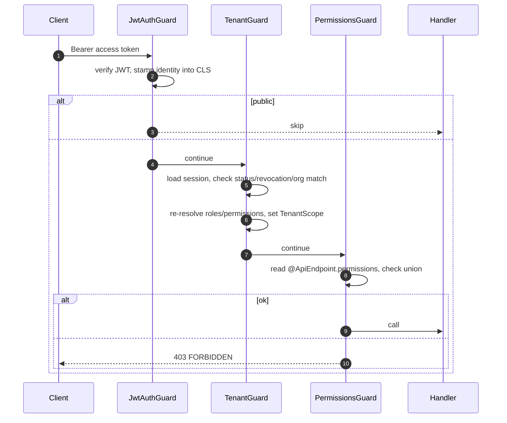

# careOS — Authorization

What a principal may do after authentication. Authentication is in
`docs/authentication.md`; multi-tenancy/branch/patient scope is in
`docs/multi-tenancy.md`.

---

## 1. Model

Authorization is **deny by default**. Every protected route declares permissions
via `@ApiEndpoint({ permissions: [...] })`; the `PermissionsGuard` enforces
them. Tenancy and session validity are enforced earlier by `TenantGuard` (and
`JwtAuthGuard`). A permission check that passes does not mean the resource
belongs to the caller's org — tenancy is enforced separately by the tenant
extension/RLS.

### Guard chain (typical)

Notes from the codebase:
- `ClsMiddleware` establishes CLS; the request id comes from Pino (`genReqId`).
- `TenantGuard` is where permissions are **re-resolved per request** from the
  session's roles (the JWT's `roles` claim is advisory only).
- `PermissionsGuard` uses the Reflector to read metadata set by `@ApiEndpoint`.

## 2. Permissions catalog

Permissions live in `src/common/auth/permissions.catalog.ts`. They are grouped
by domain (`PERMISSION_GROUPS`) and exported as a flat list
(`PERMISSION_LIST`). The system treats permission strings as the source of
truth; role keys map to unions of permissions.

From the groups present in the codebase: `dashboard`, `patients`, `scheduling`,
`clinical`, `pharmacy`, `inventory`, `billing`, `laboratory`, `radiology`,
`inpatient`, `emergency`, `nursing`, `queue`, `documents`, `reports`, `settings`,
`users`, `roles`, `audit`, `system`, `notifications`, `publicDirectory`,
`onboarding`, `sync`, `privacy`, `breakGlass`, `display`, `adminJobs`, etc.

Every permission is declared explicitly in the catalog; routes must not invent
permission strings ad hoc.

## 3. Roles and the role matrix

Roles are stored in `Role` with a key and description; assignments are
`UserRole`. The default role set is defined in `src/common/auth/role-matrix.ts`
(`DEFAULT_ROLE_LIST`) and seeded by `prisma/seed.ts`.

The seed creates deterministic demo users/roles for development. Production
role setup is an operator concern; the code does not auto-escalate.

Permission assignment is: effective permissions = union of permissions of all
roles held by the user (see `permissionUnion` used by `TenantGuard`).

## 4. Route decoration

Routes declare access via `@ApiEndpoint` (and often `@ApiOperation`,
`@ApiResponse` etc.). The decorator carries permissions; `PermissionsGuard`
enforces them. Public routes use `@Public()` (skipped by `JwtAuthGuard`).

Example pattern (from controllers): `@Post('login')` is public/throttled;
admin operations carry `permissions: [PERMISSION_GROUPS.adminJobs.manage]`
or `read` as appropriate.

## 5. Data-level scoping

Permission checks answer "can this principal perform this action?" Data
visibility is further narrowed by scope:

| Scope | How it is set | Effect |
| --- | --- | --- |
| Organization | Always set by `TenantGuard` from session | Tenant extension filters every query on `TENANT_MODELS` to `organizationId`. |
| Branch | Set from user's `UserBranch` assignments (and branch context) | Services/queries filter by branch where required (appointments, queue, devices, etc.). |
| Patient (self) | Set by `resolvePatientScope` when role is `PATIENT` and `Patient.userId` links correctly | `TenantScope.patientId` is used by portal projections and `patients.assertPatientOwnership`; see `docs/multi-tenancy.md`. |
| Department / ward | From assignments | Used by clinical/inpatient/ER scopes as needed. |

A user may have permission `patients.read` but only see patients in their
branches, or only their own record if scoped as a patient.

## 6. Special cases

### Platform jobs
Background jobs run with `TenantContext` having `isPlatformJob = true`. The
tenant extension still requires `organizationId` to be set explicitly; the
guard chain behaves differently (no browser session to revalidate). Jobs must
scope all writes/reads to the correct organization.

### Break-glass
Break-glass grants temporary, recorded access to a permission the user does not
hold. As documented in `docs/authentication.md`, requests are recorded and
never auto-activated in this phase; the mechanism is present for audit and
future activation.

### Display devices
Devices authenticate via `DeviceAuthGuard` and carry a device scope (branch,
departments). They hold only `queue.display` (and route-specific allowances);
all data is filtered by the device's recorded scope, not by request parameters.

### Audit
Sensitive actions are recorded via `AuditService`. Audit logs are
append-only (DB trigger). Inputs follow the convention: `action`, `resource`,
`resourceId`, `userId`, `metadata`, `organizationId`. The audit log is itself
org-scoped and append-only.

## 7. Admin job/DLQ inspection

Added in the recent patch:
- Permissions: `admin_jobs.read`, `admin_jobs.manage` (separate; listing is
  read-only, discard/requeue are management).
- Routes under admin jobs allow inspecting outbox/dead-letter style job state
  (reference view: job metadata/ids, not arbitrary payload dumps). 
- `DISCARDED` status exists for admin-given-up events; discard marks
  `OutboxStatus.DISCARDED` (does not delete). Requeue resets `attemptCount` to
  `0` and re-enqueues for retry.
- Queue names come from `src/jobs/queue-names.ts` (single source of truth).
- Unreachable queue must not fail the listing.

## 8. Reading map

| Topic | Where |
| --- | --- |
| Permission catalog | `src/common/auth/permissions.catalog.ts` |
| Role matrix / defaults | `src/common/auth/role-matrix.ts` |
| Guards | `src/common/guards/` (`jwt-auth.guard.ts`, `tenant.guard.ts`, `permissions.guard.ts`) |
| Decorators | `src/common/decorators/` (`api-endpoint.decorator.ts`, `public.decorator.ts`) |
| Tenant context | `src/database/tenant-context.ts` |
| Tenant extension | `src/database/prisma.service.ts` |
| Audit | `src/database/audit.service.ts` |
| Admin jobs | `src/modules/admin-jobs/` |
