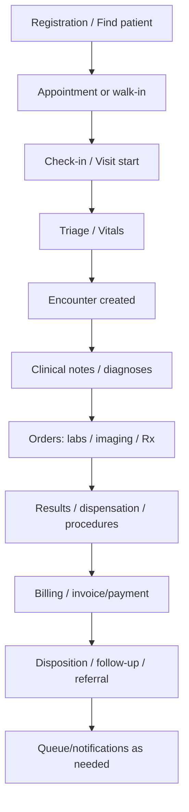

# careOS — Patient Workflow

End-to-end patient journey from registration through care delivery and
follow-up, as implemented. Grounded in routes, services, and schema.

---

## 1. Overview

The workflow spans registration, scheduling/check-in, triage/encounter,
clinical documentation, orders (lab/radiology/pharmacy), inpatient/emergency
where applicable, billing, and follow-up. Many steps are org- and branch-scoped;
portal patients see only their own records under patient scope.

## 2. Journey map

## 3. Registration and identity

- **Patients**: `Patient` model with `patientNumber` (allocated via
  `PAT-YYYY-NNNNNN` from counters), demographics, contacts, photo. Created
  through `patients` module.
- **Guardians/consents**: `Guardian`, `PatientGuardian`, `PatientConsent` track
  relationships and consent.
- **Allergies/history**: `Allergy`, `MedicalHistoryEntry` recorded per patient.
- **Access log**: `PatientAccessLog` records who accessed what (audit trail).
- **Portal link**: `Patient.userId` links to a portal login; scope is enforced
  as described in `docs/multi-tenancy.md`.

Routes/services: `src/modules/patients/`.

## 4. Scheduling and check-in

- **Appointments**: `Appointment` (status, mode, provider, branch, time).
  Bookable by authorized roles.
- **Waitlist**: `WaitlistEntry` for overbook/capacity management.
- **Visits**: `Visit` represents the patient's presence/encounter context for a
  day/episode.
- **Queue**: `QueueEntry` drives the front-desk/clinical queue; `DisplayDevice`
  shows queue state (device-authenticated, branch-scoped).
- **Provider schedules**: `ProviderSchedule`, `ScheduleOverride` control
  availability.
- **Vitals**: `VitalRecord` captured at triage/check-in.

Modules: `scheduling`, `queue`, `display`.

## 5. Triage, encounter, and clinical

- **Encounter**: `Encounter` is the clinical encounter record (type, status,
  patient, provider, branch, dates).
- **Notes**: `ClinicalNote` with `ClinicalNoteVersion` (versioned notes),
  templates in `ClinicalNoteTemplate`. Append/versioning is part of the
  clinical model.
- **Diagnoses**: `Diagnosis` linked to encounter/patient, coded via
  `CodingSystem`/`CodeConcept` (ICD-like).
- **Follow-up/referrals/tasks**: `FollowUp`, `Referral`, `Task` track
  next steps.
- **Workflows**: `Workflow`/`WorkflowTransition` model clinical pathways.

Permissions are enforced per action (e.g. `clinical.notes.write`,
`clinical.encounters.*`). Patient self-scope limits portal users to their own
encounters/notes as exposed by portal projections.

Modules: `clinical-notes`, `diagnoses`, `encounters`, `follow-ups`,
`referrals`, `tasks`, `workflows`.

## 6. Orders: laboratory, radiology, pharmacy

### Laboratory
- **Catalog**: `LabTestCategory`, `LabTest`, `LabTestField`.
- **Orders**: `LabOrder`, `LabOrderItem` (numbers via `LAB-ORD-...`).
- **Samples/results**: `LabSample` (numbers via `LAB-SMP-...`), `LabResult`.
Status flows through order/sample/result states.

### Radiology
- **Orders/studies/reports**: `RadiologyOrder`, `RadiologyStudy`,
  `RadiologyReport`. Numbering via radiology number series.

### Pharmacy/inventory
- **Catalog/stock**: `Medication`, `Supplier`, `StockBatch`, `InventoryLedgerEntry`
  (append-only). Dispensation/check-out logic uses FEFO allocation in service
  (`allocateFefo`).
- **Prescriptions**: `Prescription`, `PrescriptionItem` written by authorized
  prescribers.
- **Purchasing/transfers/counts**: `PurchaseOrder`, `StockTransfer`,
  `StockCount` track replenishment and adjustments.

Modules: `laboratory`, `radiology`, `inventory`, `pharmacy`.

## 7. Inpatient and emergency

### Inpatient
- **Structure**: `Ward`, `Bed` (status), `Admission`, `BedAssignment`,
  `Transfer`, `Discharge`. Admission numbers via `ADM-YYYY-NNNNNN`.
- **Flow**: admit -> assign bed -> transfer/discharge, with status tracking.

### Emergency
- **Visits/triage**: `EmergencyVisit`, `TriageAssessment` with priority/
  disposition.
- **Requests/resources**: `EmergencyRequest`, `EmergencyRequestEvent` (append-only),
  `EmergencyResource`, `EmergencyResourceAssignment` for coordination.
- **Intake**: emergency intake module with its own flow and events.

Modules: `inpatient`, `emergency`, `emergency-intake`.

## 8. Billing and payments

- **Items**: `BillableItem` catalog.
- **Invoices**: `Invoice`, `InvoiceItem` (numbers `INV-...`).
- **Payments**: `Payment` (numbers `RCT-...`).
- **Insurance**: `InsurancePayer`, `PatientInsurancePolicy`, `InsuranceClaim`
  (`CLM-...`).
- **Finance**: chart of accounts, journal entries/lines, `FinanceTransaction`
  with balance guard; budgets/expenses/assets tracked.

Billing is org-scoped and integrates with orders/visits/encounters as
applicable.

Modules: `billing`.

## 9. Notifications, follow-up, portal

- **Notifications**: `Notification`, `NotificationTemplate` delivered via
  channels; notification delivery tracked.
- **Patient portal**: portal module exposes patient-scoped views of
  appointments, results, invoices, etc., using `TenantScope.patientId`.
- **Messaging/feedback**: `MessageThread`, `Message`, `Feedback`, `Complaint`.
- **Tasks/follow-ups**: drive post-visit actions.

## 10. Data flow notes

- **Outbox**: state changes that need to be propagated (sync, notifications,
  etc.) go through the transactional outbox (`OutboxEvent`) with payloads
  containing IDs only. The `outbox-drain` processor publishes them.
- **Sync feed**: `ChangeLog` is derived from outbox events and filtered by
  `requiredPermission` for consumers.
- **Audit**: significant actions write to `AuditLog` (append-only).
- **Idempotency**: mutating endpoints can use idempotency keys recorded in
  `IdempotencyRecord`.

## 11. Reading map

| Area | Modules/files |
| --- | --- |
| Patients | `src/modules/patients/` |
| Scheduling/queue/display | `src/modules/scheduling/`, `src/modules/queue/`, `src/modules/display/` |
| Clinical | `src/modules/encounters/`, `src/modules/clinical-notes/`, `src/modules/diagnoses/`, `src/modules/workflows/` |
| Lab/rad/pharm/inv | `src/modules/laboratory/`, `src/modules/radiology/`, `src/modules/pharmacy/`, `src/modules/inventory/` |
| Inpatient/ER | `src/modules/inpatient/`, `src/modules/emergency/`, `src/modules/emergency-intake/` |
| Billing/finance | `src/modules/billing/` |
| Portal/notifications | `src/modules/portal/`, `src/modules/notifications/` |
| Outbox/sync | `src/modules/outbox/`, `src/modules/sync/` |
